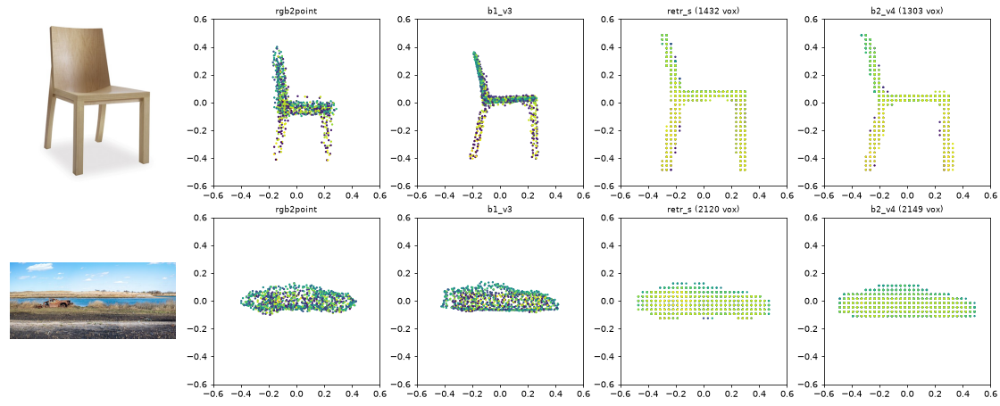

<div align="center">

# Image to 3D with Transformers

[](https://github.com/iLogicus/image-to-3d-transformer/actions)
[](https://image-to-3d-98814186060.asia-southeast1.run.app)

One photo in, a 3D point cloud and a voxel grid out.

[Live demo](https://image-to-3d-98814186060.asia-southeast1.run.app) | [Report](reports/report.pdf) | [Slides](reports/slide.pptx) | [Video](reports/demo_video.mp4) | [Data and checkpoints](https://drive.google.com/drive/folders/1a3uJbDSbtzmmrHbJdoV02D4LfoUdznkw?usp=sharing)



</div>

FPTU DPL final project, Topic 3, Group 8 (supervisor: Nguyễn Xuân Huy). We reproduce two Transformer baselines on ShapeNet (airplane, car, chair) and improve each one step by step, one change per version, guided by failure analysis.

| Baseline | Output | Our best version |
|---|---|---|
| [RGB2Point](https://github.com/JaeLee18/RGB2point) (WACV 2025) | 1024-point cloud | V3: CD 3.985 -> 3.424, Pix3D CD 6.545 -> 5.486 |
| [3D-RETR-S](https://github.com/FomalhautB/3D-RETR) (BMVC 2021) | 32³ voxels | V4: Pix3D IoU 0.293 -> 0.327 |

CD x100, lower is better; IoU, higher is better. ShapeNet test set and Pix3D real chair photos. Checkpoints chosen on validation only; single run with seed 0. Full ablation and analysis: [report](reports/report.pdf).

## Run the demo

Online: [live demo](https://image-to-3d-98814186060.asia-southeast1.run.app) and REST API at [`/docs`](https://image-to-3d-98814186060.asia-southeast1.run.app/docs).

> [!TIP]
> The server sleeps when unused, so the first visit takes about a minute.

Locally (CPU), then open http://localhost:7860:

```bash
docker compose up --build
```

Without Docker (Python 3.12):

```bash
pip install torch==2.11.0 torchvision==0.26.0 --index-url https://download.pytorch.org/whl/cpu
pip install -r requirements-demo.txt
python api/main.py                                        # demo + API
python src/inference.py --image chair.jpg --model b1_v3   # command line, writes .ply / .obj
```

Weights are downloaded once from [Hugging Face](https://huggingface.co/iLogicus/image-to-3d-weights).

## Reproduce the experiments

1. Add the shared [Drive folder](https://drive.google.com/drive/folders/1a3uJbDSbtzmmrHbJdoV02D4LfoUdznkw?usp=sharing) `DPL_Final` (data, checkpoints, logs) to your `MyDrive`.
2. Open [notebooks/Baseline_1.ipynb](notebooks/Baseline_1.ipynb) or [notebooks/Baseline_2.ipynb](notebooks/Baseline_2.ipynb) in Colab (GPU L4, High-RAM) and run all cells.

Each notebook clones this repo, installs `requirements.txt` and calls the scripts in `src/` with one config from `configs/` per experiment.

Environment: Google Colab Pro, NVIDIA L4 24 GB, bf16, Python 3.13, PyTorch 2.11, timm 1.0.30, seed 0.

## Team

| Member | Work |
|---|---|
| Đỗ Nguyễn Hữu Phúc | Data, baselines, all versions, demo, API, Docker, CI/CD, report |
| Nguyễn Tiến Vinh | Report review, screenshots |
| Phạm Trường Minh Nhật | Slides, demo video |

AI use (Claude, Anthropic) is declared in the report, Appendix B.

## References

- RGB2Point: J. J. Lee, B. Benes, WACV 2025. [Code, data, weights](https://github.com/JaeLee18/RGB2point).
- 3D-RETR: Z. Shi et al., BMVC 2021. [Code, split](https://github.com/FomalhautB/3D-RETR).
- Data: ShapeNet (Chang et al. 2015), 3D-R2N2 (Choy et al. 2016, via the Hugging Face mirror `learning3dvision/r2n2_shapenet_dataset_full`), 3D-LMNet point clouds (Mandikal et al. 2018), Pix3D (Sun et al. 2018).
- Models: ViT (Dosovitskiy et al. 2021), DeiT (Touvron et al. 2021), DINOv2 (Oquab et al. 2024) with registers (Darcet et al. 2024), via [timm](https://github.com/huggingface/pytorch-image-models); U²-Net (Qin et al. 2020) via [rembg](https://github.com/danielgatis/rembg). Demo built with Gradio, FastAPI and trimesh.
- Demo photos (Wikimedia Commons): "Library Chair dakota jackson.jpg" by Dakota Jackson Inc., CC BY-SA 3.0; "Abandoned car in Marine Park (10852p).jpg" by Rhododendrites, CC BY-SA 4.0.
